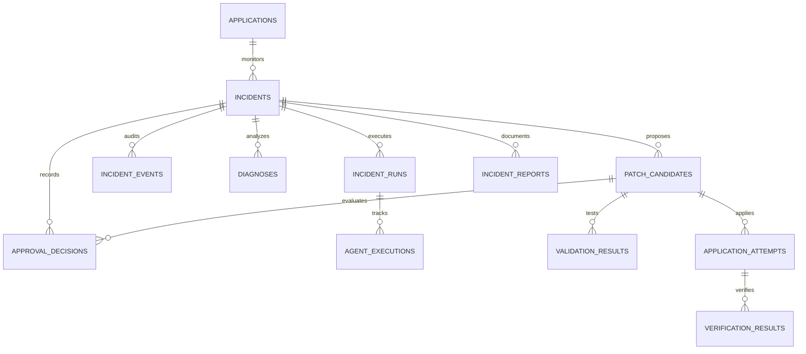

# SENTINEL AI ? Database Schema Documentation

The backend uses **SQLAlchemy 2.0** with **SQLite** (`sqlite+aiosqlite:///./sentinel.db`) in async mode. All identifiers use UUIDs, timestamps are in UTC ISO-8601, and foreign keys enforce referential integrity.

---

## Entity Relational Diagram

---

## Table Definitions

### 1. `applications`
- `id` (PK, String): Unique application ID (`app_demo`).
- `name` (String): Display name.
- `description` (Text): Application description.
- `workspace_key` (String): Server-side workspace folder identifier.
- `repository_revision` (String): Current commit hash/tag.
- `monitoring_enabled` (Boolean): Monitoring toggle.
- `status` (String): `healthy` | `degraded` | `offline`.
- `supported_errors` (Text, JSON): Array of supported error types.
- `created_at`, `updated_at` (DateTime, UTC).

### 2. `incidents`
- `id` (PK, String): Incident identifier (`inc_...`).
- `application_id` (FK -> `applications.id`): Monitored app.
- `source_event_id` (String): External event tracking ID.
- `fingerprint` (String, Unique): De-duplication key.
- `severity` (String): `low` | `medium` | `high` | `critical`.
- `error_type` (String): Normalized failure classification.
- `message` (Text): Human-readable error description.
- `source_log` (Text): Redacted log context snippet.
- `status` (String): Current workflow run state.
- `current_stage` (String): Stage name.
- `repository_revision` (String): Revision when incident occurred.
- `active_run_id` (String, Nullable): Currently running workflow run ID.
- `detected_at` (DateTime, UTC).
- `resolved_at` (DateTime, UTC, Nullable).
- Indexes: `uq_incident_fingerprint`, `ix_incidents_app_status_detected`.

### 3. `incident_runs`
- `id` (PK, String): Workflow execution run ID.
- `incident_id` (FK -> `incidents.id`).
- `schema_version` (String): Wire schema version (`1.0`).
- `state` (String): Execution state.
- `attempt` (Integer): Attempt counter.
- `started_at`, `finished_at` (DateTime, UTC).
- `last_error` (Text, Nullable).

### 4. `agent_executions`
- `id` (PK, String): Agent invocation record.
- `run_id` (FK -> `incident_runs.id`).
- `agent_type` (String): `manager` | `monitoring` | `diagnosis` | `repair` | `testing` | `reporting`.
- `status` (String): `idle` | `running` | `completed` | `error` | `offline`.
- `input_revision` (String).
- `started_at`, `completed_at` (DateTime, UTC).
- `duration_ms` (Integer).
- `error_json` (Text, JSON).
- `output_artifact_id` (String, Nullable).

### 5. `incident_events` (Append-Only Audit Log)
- `id` (PK, String): Event ID.
- `incident_id` (FK -> `incidents.id`).
- `run_id` (String, Nullable).
- `event_type` (String): State transition or action event.
- `actor_type` (String): `agent` | `human` | `system`.
- `actor_id` (String): Actor identifier.
- `payload_json` (Text, JSON): Serialized event context.
- `occurred_at` (DateTime, UTC).
- Index: `ix_events_incident_occurred`.

### 6. `diagnoses`
- `id` (PK, String): Diagnosis record ID.
- `incident_id` (FK -> `incidents.id`).
- `run_id` (String).
- `hypothesis` (Text): Root-cause theory.
- `confidence_label` (String): `low` | `medium` | `high`.
- `uncertainty` (Text): Limitations and assumptions.
- `suggested_direction` (Text): Advice for repair.
- `evidence_json` (Text, JSON): Array of cited source excerpts.
- `status` (String): `completed` | `manual_review`.

### 7. `patch_candidates`
- `id` (PK, String): Candidate patch ID (`patch_...`).
- `incident_id` (FK -> `incidents.id`).
- `run_id` (String).
- `version` (Integer): Incremental version number.
- `base_revision` (String): Target commit hash.
- `patch_hash` (String): SHA-256 hash of unified diff.
- `diff_artifact_id` (String, Nullable).
- `diff_content` (Text): Raw unified diff text.
- `changed_files_json` (Text, JSON): List of modified paths.
- `rationale` (Text): Explanation of fix.
- `status` (String): `proposed` | `validated` | `failed` | `stale` | `approved` | `rejected` | `applied`.
- Index: `ix_candidates_incident_version`.

### 8. `validation_results`
- `id` (PK, String).
- `candidate_id` (FK -> `patch_candidates.id`).
- `patch_hash` (String).
- `status` (String): `passed` | `failed` | `error` | `timeout` | `not_run`.
- `checks_json` (Text, JSON): Array of individual test check results.
- `environment_id` (String): Disposable test environment name.
- `evidence_artifact_id` (String, Nullable).
- `duration_ms` (Integer).

### 9. `approval_decisions`
- `id` (PK, String).
- `incident_id` (FK -> `incidents.id`).
- `candidate_id` (FK -> `patch_candidates.id`).
- `patch_hash` (String).
- `base_revision` (String).
- `decision` (String): `approve` | `reject`.
- `actor_id` (String): Reviewer identity derived from authenticated session.
- `comment` (Text, Nullable).
- `decided_at` (DateTime, UTC).

### 10. `application_attempts`
- `id` (PK, String).
- `candidate_id` (FK -> `patch_candidates.id`).
- `snapshot_ref` (String): Server path to pre-patch snapshot.
- `before_revision` (String).
- `after_revision` (String, Nullable).
- `status` (String): `applying` | `verifying` | `resolved` | `unresolved`.
- `applied_at` (DateTime, UTC).
- `restore_status` (String): `not_needed` | `restored` | `manual_action`.

### 11. `verification_results`
- `id` (PK, String).
- `application_attempt_id` (FK -> `application_attempts.id`).
- `candidate_id` (String).
- `status` (String): `passed` | `failed` | `error` | `timeout`.
- `checks_json` (Text, JSON).
- `monitoring_observation_json` (Text, JSON).
- `evidence_artifact_id` (String, Nullable).

### 12. `incident_reports`
- `id` (PK, String).
- `incident_id` (FK -> `incidents.id`).
- `version` (Integer).
- `outcome` (String): Terminal run state.
- `report_artifact_id` (String).
- `summary_json` (Text, JSON): Summary and limitations list.
- `generated_at` (DateTime, UTC).

### 13. `artifacts`
- `id` (PK, String).
- `kind` (String): `diff` | `report` | `test_log` | `code_excerpt`.
- `storage_key` (String).
- `sha256` (String).
- `content_type` (String).
- `redacted` (Boolean).
- `size_bytes` (Integer).
- `content` (Text).

### 14. `code_index_entries`
- `id` (PK, String).
- `application_id` (String).
- `repository_revision` (String).
- `file_path` (String).
- `symbol` (String).
- `start_line`, `end_line` (Integer).
- `content_hash` (String).
- `index_ref` (String).

### 15. `settings`
- `key` (PK, String).
- `value_json` (Text, JSON).
- `updated_at` (DateTime, UTC).
