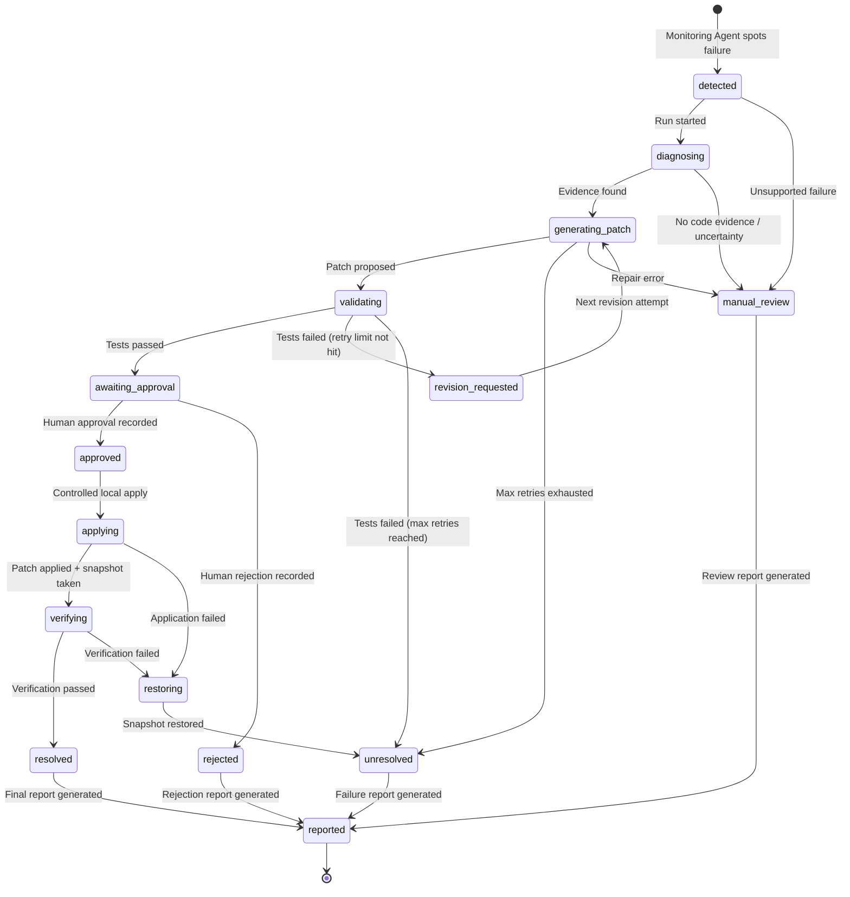

# SENTINEL AI ? Workflow Orchestration Documentation

## 1. State Machine Overview

The SENTINEL AI recovery workflow is implemented as a persistent, deterministic finite state machine managed exclusively by the **Manager Agent** (`backend/app/services/manager.py`).

Every state transition is:
1. Validated against allowed edges.
2. Atomically written to the database.
3. Appended to the immutable audit event log (`incident_events`).
4. Re-entrant and resilient to server restarts.

---

## 2. Transition Diagram

---

## 3. Detailed Stage Lifecycle & Invariants

### Stage 1: Detection & Ingestion
- **Agent**: Monitoring Agent (Neha)
- **Invariant**: Every event is hashed by `fingerprint`. Duplicates map to the existing incident and do not spawn redundant parallel runs.

### Stage 2: Diagnosis & Code RAG
- **Agent**: Diagnosis Agent (Sahad)
- **Invariant**: Code references must tie directly to the application's revision at the time of failure. If no conclusive evidence is found, transition to `manual_review` rather than hallucinating a cause.

### Stage 3: Patch Generation
- **Agent**: Repair Agent (Yadhulakshmi)
- **Invariant**: Generates a unified diff with SHA-256 hash. Enforces revision limit (`max_candidate_revisions`). Malformed diffs or path traversals fail immediately.

### Stage 4: Isolated Validation
- **Agent**: Testing Agent (Sravan)
- **Invariant**: Runs reproduction tests and smoke regression checks in an isolated environment. The Manager **never** transitions to `awaiting_approval` unless every check passes with exit code 0.

### Stage 5: Human Approval Gate
- **Actor**: Human Reviewer
- **Invariants**:
  - Independent server-side check of candidate ID, patch SHA-256, and base repository revision.
  - The application's current revision must match `base_revision`.
  - Rejection immediately transitions to `rejected` and triggers the Reporting Agent without touching the repository.

### Stage 6: Controlled Patch Application
- **Actor**: Server Patch Service (`PatchApplicationService`)
- **Invariants**:
  - Allowed **only** on the configured demo workspace (`app_demo`).
  - Creates a full workspace snapshot before applying any modification.
  - Path traversal checks ensure edits remain inside the allowed repository directory.
  - On any failure, automatically restores the snapshot and marks status as `restored`.

### Stage 7: Post-Application Verification
- **Agent**: Testing Agent (Sravan) & Monitoring Agent (Neha)
- **Invariants**:
  - Reruns reproduction test on the live patched workspace.
  - If verification fails, rolls back the snapshot and marks `unresolved`.

### Stage 8: Reporting & Resolution
- **Agent**: Reporting Agent (Neha)
- **Invariants**:
  - Compiles an immutable summary containing facts, decisions, test metrics, and explicit prototype limitations.
  - Updates incident terminal state to `reported`.

---

## 4. Background Dispatcher & Crash Recovery

### Durable Workflow Dispatcher
Rather than relying on volatile in-memory queues or fire-and-forget background tasks, the `WorkflowDispatcher` (`backend/app/workers/dispatcher.py`):
- Persists all execution state immediately to the database before and after each phase.
- Wraps each agent execution in bounded timeouts (`asyncio.wait_for`) to prevent hung workers.
- Records all agent inputs, outputs, tokens, and duration metrics in `agent_executions`.

### Automatic Startup Recovery
Upon server start or reboot, FastAPI lifespan hooks invoke `manager.resume_interrupted_workflows()`:
- Queries any incident runs stuck in transient states (`diagnosing`, `generating_patch`, `validating`, `applying`, `verifying`).
- Inspects persisted database records to determine the latest completed phase.
- Resumes execution automatically from the exact point of interruption without losing state or creating duplicate runs.

